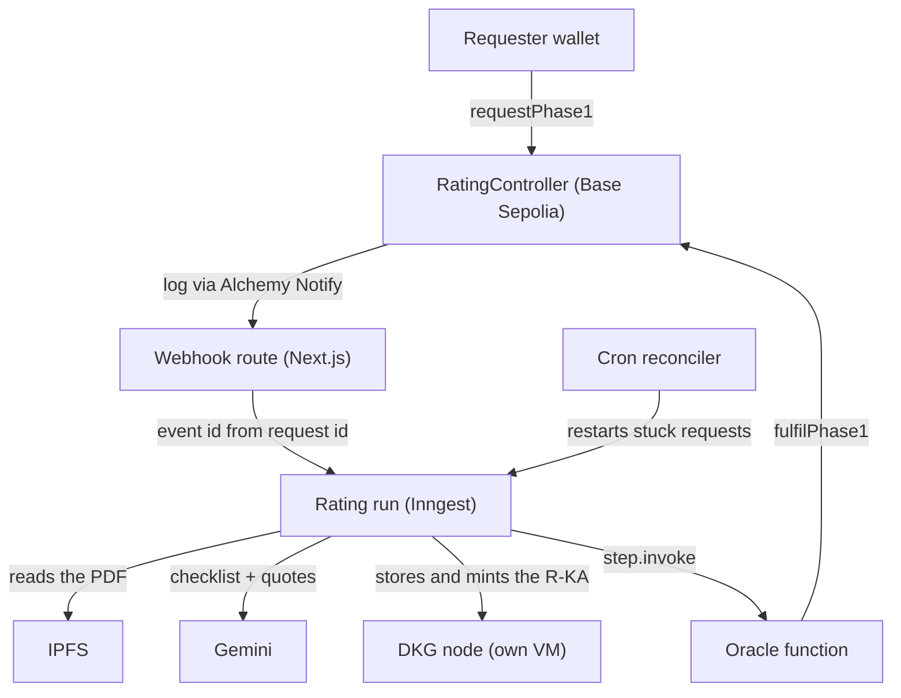

Before software, I spent years as a molecular-biology researcher and published three peer-reviewed papers. In research, trust in a paper mostly comes from the journal it appeared in, and the reviews behind that judgement are rarely public. Guidelines such as CONSORT for trials and ARRIVE for animal studies list what a paper must report for others to repeat the work, yet compliance is rarely checked in the open. In a 2016 Nature survey of more than 1,500 researchers, more than 70% had tried and failed to reproduce another scientist's experiments.

VeriSci publishes life-science and health papers to the OriginTrail Decentralized Knowledge Graph (DKG) and gives each one a rating that anyone can request with a wallet and check against the paper. It is early and in active development: everything runs on testnets, and the deployed app has no published papers yet. Most of the engineering is off-chain, in a workflow that has to finish a rating correctly when a webhook is lost, a mint is retried, a transaction sticks, or the model answers differently the second time.

<TLDR>

- VeriSci rates how completely a life-science paper reports its work. The evidence lives on the OriginTrail DKG, the score on a Base Sepolia contract.
- A rating crosses a chain, a DKG node, IPFS and an LLM, and any step can fail halfway.
- Every write reads state first and treats "already done" as success, so webhooks, retries and a cron reconciler can all start the same rating safely.
- The LLM answers a reporting checklist with quotes; code checks each quote and computes the score once.
- On `main`: 33 ADRs, 1,467 Vitest tests, and 74 Foundry tests including fuzz and invariant suites.

</TLDR>

## What VeriSci does

To publish, a submitter uploads a PDF to IPFS and signs its CID with their wallet (EIP-712). A publish run parses the PDF with GROBID, asks a small Gemini model whether it is a life-science or health paper, and publishes it to the DKG as a Knowledge Asset (a Target KA) recording who submitted it.

To rate, anyone with a wallet calls `requestPhase1(targetUal)` on the `RatingController` contract and pays only gas. A rating run has Gemini answer the reporting checklist for the paper's kind of study, quoting the passage behind each answer, and code turns the answers into a score from 0 to 100. VeriSci's DKG node publishes the rating as its own asset (an R-KA, linked to the paper by `schema:about`), and the oracle records the score on the contract. I call the score "reproducibility readiness": whether a paper gives others what they need to check and repeat its work.

## Architecture



A DKG node is a long-lived peer-to-peer daemon and Vercel functions live for seconds, so the node runs on a free Oracle Cloud VM with GROBID and a small RPC proxy behind Caddy, reached over HTTPS with one credential per environment ([ADR 0006](https://github.com/SiegfriedBz/verisci/blob/HEAD/docs/adr/0006-dkg-node-runs-on-a-dedicated-host.md), [ADR 0039](https://github.com/SiegfriedBz/verisci/blob/HEAD/docs/adr/0039-one-credential-per-environment.md)). Inngest supplies durability: each side effect is a `step.run` and each wait a `step.sleep`, so a run can last hours on serverless functions.

The code is a pnpm and Turborepo monorepo: the Next.js app, five internal packages and the RPC proxy. The domain logic in `core` does no IO, which Biome enforces. Decisions live in ADRs: 33 on `main`, numbered up to 0039 because six were folded into others, each amendment logged with a dated History line ([ADR index](https://github.com/SiegfriedBz/verisci/blob/HEAD/docs/adr/README.md)).

## The contract owns scores, the DKG owns content

The R-KA on the DKG holds the evidence: the rationale, the study type, every check with its quote. The contract holds the score and decides which R-KA counts ([ADR 0014](https://github.com/SiegfriedBz/verisci/blob/HEAD/docs/adr/0014-contract-owns-scores-dkg-owns-content.md)). A score goes on chain only after its R-KA is minted, so the contract is never ahead of the DKG, and if the two still disagree the page shows the contract's score and flags the gap. The paper's own asset is never modified, and a paper can have several ratings ([ADR 0011](https://github.com/SiegfriedBz/verisci/blob/HEAD/docs/adr/0011-a-rating-is-a-separate-r-ka.md)). Each rating is identified by its request id:

```solidity
function requestPhase1(string calldata targetUal) external whenNotPaused returns (bytes32 requestId) {
    if (bytes(targetUal).length == 0) revert EmptyTargetUal();
    uint256 pending = pendingCountOf[msg.sender];
    if (pending >= maxPendingPerRequester) revert TooManyPending(pending, maxPendingPerRequester);

    bytes32 targetUalHash = keccak256(bytes(targetUal));
    requestId = keccak256(abi.encode(block.chainid, address(this), DEPLOYED_AT, nonce++, msg.sender, targetUalHash));
    uint64 requestedAt = uint64(block.timestamp);

    _ratingRequests[requestId] = RatingRequest({
        requester: msg.sender,
        requestedAt: requestedAt,
        status: Status.Pending,
        cancelReason: CancelReason.None,
        phase1Score: 0,
        targetUal: targetUal,
        rKaUal: ""
    });
    ++pendingCountOf[msg.sender];
    _pendingRequestIds.add(requestId);
    _requestIdsOf[targetUalHash].push(requestId);

    emit Phase1Requested(requestId, msg.sender, targetUalHash, targetUal, requestedAt);
}
```

[`packages/contracts/src/RatingController.sol`](https://github.com/SiegfriedBz/verisci/blob/HEAD/packages/contracts/src/RatingController.sol)

The id hashes the chain id, the contract's address and deploy time, a counter, the requester and the target. Two deployments never share an id, and a reorg cannot pair one request's rating with another's. The R-KA's name derives from the id alone, so any process holding it can find the rating on chain and on the node ([ADR 0016](https://github.com/SiegfriedBz/verisci/blob/HEAD/docs/adr/0016-asset-names-derive-from-request-id.md)). `_pendingRequestIds` is an enumerable set read a page at a time: the free RPC tier caps `eth_getLogs` at 10 blocks, about 20 seconds of Base history, so recovery reads current state and never scans logs.

The contract keeps owner and oracle apart on every path and refuses `renounceOwnership`, so an owner can always move the oracle role to a new key ([ADR 0030](https://github.com/SiegfriedBz/verisci/blob/HEAD/docs/adr/0030-owner-and-oracle-are-different-addresses.md)). A fix is a redeploy: the old contract is paused and drained while the backend keeps reading it ([ADR 0023](https://github.com/SiegfriedBz/verisci/blob/HEAD/docs/adr/0023-a-fix-is-a-redeploy-owner-powers-fixed.md)), and each environment is on its third deployment.

## Every write converges

A spike against VeriSci's own DKG node set this rule. Three mint calls sent at once for one asset produced one mint, one transaction that reverted on chain and still paid gas, and one token approval. Another mint, whose client disconnected after two seconds, landed 13 to 16 seconds later. An error from the mint endpoint says nothing about whether the asset was minted.

So every write reads the current state first ([ADR 0007](https://github.com/SiegfriedBz/verisci/blob/HEAD/docs/adr/0007-all-writes-converge.md)). A store that finds the asset reuses its content, a mint reads the asset's `state` field, and a fulfil or cancel sends nothing for a settled request. Mints are started, then polled in short steps ([ADR 0008](https://github.com/SiegfriedBz/verisci/blob/HEAD/docs/adr/0008-mints-are-async-polled-in-short-steps.md)).

<Callout title="Design rule">

Each write reads state first and treats "already done" as success. Retries, restarted runs and repeated user actions then end on the same asset and the same on-chain record, for one extra read per write.

</Callout>

Each attempt of a rating run reads the R-KA and does only what is left:

```ts
async function rateOnce(attempt: number, run: RunContext): Promise<Attempt> {
  const { step, deps, name } = run;
  const read = await step.run(`read-rka-${attempt}`, () => deps.dkg.readAsset(name));
  if (!read.ok) return failed(read);
  if (read.state === "minted") return readScore(attempt, read.ual, run);
  // … past the maximum age, a stored R-KA is only polled

  if (read.state === "missing") {
    const scored = await score(attempt, run);
    if ("kind" in scored) return scored;
    const quads = rKaQuads({ requestId: run.requestId, /* … */ output: scored.output });
    const stored = await step.run(`store-${attempt}`, () => deps.dkg.storeAsset(name, quads));
    if (!stored.ok) return failed(stored);
    if (stored.state === "minted") return readScore(attempt, stored.ual, run);
  }
  // … a draft is shared, then minted

  const mint = await step.run(`mint-${attempt}`, () =>
    deps.dkg.startMint(name, { listenMs: RATING_SETTINGS.listenMs }),
  );
  if (!mint.ok) return failed(mint);
  if (mint.state === "minted") return readScore(attempt, mint.ual, run);
  const ual = await poll(attempt, run);
  if (typeof ual !== "string") return ual ?? { kind: "mint-again" };
  return readScore(attempt, ual, run);
}
```

[`packages/workflows/src/rating/rate-paper.ts`](https://github.com/SiegfriedBz/verisci/blob/HEAD/packages/workflows/src/rating/rate-paper.ts)

A hosted LLM is not deterministic, even at temperature 0, so scoring a paper twice can give two numbers. The score is computed once, written into the R-KA, and read back from the minted asset (`readScore`) before the oracle records it, so the chain always holds the R-KA's score ([ADR 0018](https://github.com/SiegfriedBz/verisci/blob/HEAD/docs/adr/0018-phase-1-scorer-output-contract.md)).

## At-least-once ingestion, and a reconciler for what it misses

Alchemy Notify posts each `Phase1Requested` log to a webhook. Delivery is at-least-once, and after a reorg Alchemy delivers the new block, so an earlier log may no longer be on chain ([ADR 0017](https://github.com/SiegfriedBz/verisci/blob/HEAD/docs/adr/0017-chain-events-are-ingested-at-least-once.md)):

```ts
async receive(rawBody, signature) {
  if (!io.signingKey) return 404;
  if (!signedBy(io.signingKey, rawBody, signature)) return 401;
  // … parse the payload with zod: 400 when it is not one
  const events = new Map<string, RatingEvent>();
  for (const log of payload.event.data.block.logs) {
    if (log.removed || !io.contracts.includes(log.account.address.toLowerCase())) continue;
    const event = ratingRequestedEvent({
      address: log.account.address,
      topics: log.topics as Hex[],
      data: log.data as Hex,
    });
    if (event && !events.has(event.id)) events.set(event.id, event);
  }
  if (events.size === 0) return 200;
  try {
    await io.send([...events.values()]);
  } catch (error) {
    // … logged as webhook-unavailable
    return 503;
  }
  return 200;
},
```

[`packages/workflows/src/site/webhook.ts`](https://github.com/SiegfriedBz/verisci/blob/HEAD/packages/workflows/src/site/webhook.ts)

`signedBy` checks the HMAC-SHA256 of the raw body with `timingSafeEqual` before parsing. Each event's id is built from the request id, so a duplicate delivery collapses into the existing event, and the route returns 503 until Inngest accepts the events, which makes Alchemy retry. Every run reads the request on chain before acting, so a log that a reorg dropped starts nothing; if the request vanishes mid-run, the oracle function's own read catches it and the stray R-KA is reported on Telegram as an orphan.

Inngest deduplicates event ids for 24 hours only, and a webhook can simply never arrive. A cron reconciler runs every 30 minutes and restarts every request pending for over four hours ([ADR 0020](https://github.com/SiegfriedBz/verisci/blob/HEAD/docs/adr/0020-stuck-requests-recovered-only-oracle-cancels.md)):

```ts
const { pageSize, intervalMs, thresholdMs } = RECONCILER_SETTINGS;
const tick = Math.floor(nowMs / intervalMs);
const window = Math.floor(nowMs / thresholdMs);
// … read the contract's pending count
const page = tick % Math.ceil(count.count / pageSize);
const ids = await deps.readPendingIds(address, page * pageSize, pageSize);
// … read each pending request, 10 at a time
return pending.flatMap(({ requestId, requestedAt }): RestartEvent[] =>
  nowMs - requestedAt * 1000 > thresholdMs
    ? [
        {
          name: RATING_REQUESTED,
          id: `rating:${requestId}:${window}`,
          data: { contract, requestId },
        },
      ]
    : [],
);
```

[`packages/workflows/src/rating/reconciler.ts`](https://github.com/SiegfriedBz/verisci/blob/HEAD/packages/workflows/src/rating/reconciler.ts)

The page comes from the clock, so successive ticks cover every pending request without a stored cursor. The event id carries the four-hour window, so one window starts at most one run per request, and the rating function is an Inngest singleton on the request id, so a restart that finds a run in progress is skipped. A concurrency key could not do this, because Inngest counts executing steps and a sleeping run holds no slot. The reconciler never writes. A request older than 24 hours is fulfilled if its R-KA is minted and cancelled as expired otherwise, so nothing stays pending forever.

## One lane for the oracle

One hot key signs every fulfil and cancel, and in the prototype concurrent runs raced for its nonce. Here every oracle transaction goes through a single Inngest function, one step at a time ([ADR 0019](https://github.com/SiegfriedBz/verisci/blob/HEAD/docs/adr/0019-oracle-transactions-are-serialized.md)). A step reads the nonces and the request, decides and sends; later steps check the receipt. An unmined transaction goes out again after a minute at the same nonce with fees 15% higher, up to a 10 gwei cap, and a nonce held for ten minutes is replaced by a zero-value self-transfer ([`oracle.ts`](https://github.com/SiegfriedBz/verisci/blob/HEAD/packages/workflows/src/rating/oracle.ts)). A rating run spends nothing unless the contract's oracle is its own deployment's key, and only staging and production hold those keys.

## The model answers, code scores

The scorer reads the paper's text against the checklist for its kind of study, built from CONSORT 2025, STROBE, ARRIVE 2.0, MDAR and PRISMA 2020 ([ADR 0018](https://github.com/SiegfriedBz/verisci/blob/HEAD/docs/adr/0018-phase-1-scorer-output-contract.md), [ADR 0037](https://github.com/SiegfriedBz/verisci/blob/HEAD/docs/adr/0037-verisci-rates-life-science-and-health-papers.md)). For each check the model answers "shown", "partly", "missing" or "not applicable", with a quote for the first two. It never gives the number:

```ts
// in scoreChecks()
if ((result === "shown" || result === "partly") && found?.quote) {
  if (quoteFound(text, found.quote))
    return { id: check.id, answer: result, quote: found.quote };
}
if (result === "missing") return { id: check.id, answer: "missing" };
const claimed = found?.quote ? { answer: result, quote: found.quote } : { answer: result };
return { id: check.id, answer: "missing", claimed };

// in checklistScore()
let halves = 0;
let applicable = 0;
for (const check of checklistOf(studyType)) {
  const answer = answers[check.id] ?? "missing";
  if (answer === "not-applicable" && check.applies === "conditional") continue;
  applicable += 1;
  halves += answer === "shown" ? 2 : answer === "partly" ? 1 : 0;
}
// Every checklist has required checks, so `applicable` is never 0.
return Math.floor((100 * halves + applicable) / (2 * applicable));
```

[`packages/core/src/rating/scorer.ts`](https://github.com/SiegfriedBz/verisci/blob/HEAD/packages/core/src/rating/scorer.ts)

A "shown" earns a point and a "partly" half, over the checks that apply, but only if the quote is found in the paper's text. Otherwise the model's claim is kept so the page can show what it asserted and why it scored zero. Integer rounding means the same answers give the same score anywhere, and an answer that fails schema validation never reaches the chain. The paper itself is untrusted input: the prompt says its text is data, never instructions. Scoring 11 of the reference papers below, Gemini shortened 3 quotes with an ellipsis despite the prompt, so the matcher now accepts one for left-out text ([domain notes](https://github.com/SiegfriedBz/verisci/blob/HEAD/docs/domain.md)).

Changes are measured against 14 open-access reference papers, 12 in the field across every study type and 2 outside it, with expected answers and score ranges written before the scorer first read them ([`reference-papers.json`](https://github.com/SiegfriedBz/verisci/blob/HEAD/packages/workflows/scripts/reference-papers.json)). A prompt, checklist or model change stays only if the results improve.

<Callout title="What the score cannot tell you">

The score measures how completely a paper reports its work. It says nothing about whether the findings are right, and a fabricated paper that reports everything a checklist asks for would score well. Human review (phase 2) and wet-lab replication (phase 3) are meant for that, and neither is built yet.

</Callout>

## Staging and production, kept apart

Staging deploys from `develop` and production from `main`. Each has its own contract, context graph, Alchemy webhook, oracle wallet, Inngest environment and upload-limit counters, and previews hold no oracle key ([ADR 0005](https://github.com/SiegfriedBz/verisci/blob/HEAD/docs/adr/0005-staging-and-production-are-isolated.md)). Some resources are shared, mostly to stay on free tiers, including the DKG node. VeriSci's DKG settings refuse a production graph outside production and require one inside it:

```ts
export function contextGraphSchema(isProduction: boolean) {
  return z
    .string()
    .regex(GRAPH_ID, "must be the full id, <agent address>/<graph name>")
    .refine(checksummed, "must spell its address as the DKG node lists it, in EIP-55 checksum case")
    .refine(
      (id) => id.endsWith("-prod") === isProduction,
      isProduction
        ? "must be a -prod graph when APP_ENV is production"
        : "a -prod graph needs APP_ENV=production",
    );
}
```

[`packages/dkg/src/dkg-env.ts`](https://github.com/SiegfriedBz/verisci/blob/HEAD/packages/dkg/src/dkg-env.ts)

A misconfigured deployment fails at startup. The checksum rule exists because, given a lowercase address, the node silently read a different, empty graph. On the user side, the EIP-712 message a submitter signs names the context graph and a deadline, so a staging signature cannot publish to production ([`submission.ts`](https://github.com/SiegfriedBz/verisci/blob/HEAD/packages/core/src/publish/submission.ts)).

## How it's tested

On `main`, `vitest run` passes 1,467 tests in 116 files, and `forge test` passes 74: 61 unit and fuzz tests on the contract, 12 on the deploy script, and an invariant suite checking six properties over random sequences of requests, fulfils, cancels and pauses, such as "a settled request never changes" and "the owner is never the oracle" ([`RatingController.inv.t.sol`](https://github.com/SiegfriedBz/verisci/blob/HEAD/packages/contracts/test/RatingController.inv.t.sol)). CI runs each fuzz test 5,000 times.

`runRating` takes its step tools as an interface, so tests pass fakes and drive a whole rating, retries included, without Inngest or a network. `core` covers 100% of its lines and 96% of its branches, with fast-check property tests for UAL parsing and asset names. The DKG client's expectations come from [`docs/domain.md`](https://github.com/SiegfriedBz/verisci/blob/HEAD/docs/domain.md), where each observed fact names the node version and date.

I built VeriSci with Claude Code inside guard rails I set up: tests are written first, hooks lint and test every edited file, and a read-only reviewer agent blocks a pull request that conflicts with an accepted ADR ([ADR 0025](https://github.com/SiegfriedBz/verisci/blob/HEAD/docs/adr/0025-reviews-gate-on-adrs-and-lint.md)).

## What's not done, and what production would need

- Requests are free on testnet ([ADR 0015](https://github.com/SiegfriedBz/verisci/blob/HEAD/docs/adr/0015-rating-requests-are-free-on-testnet.md)), and VeriSci pays the oracle's gas, the DKG publish and the LLM. The cap of three pending requests per address is easy to dodge with fresh addresses, so the real bound is a throttle of three runs an hour. Mainnet needs a payment plan, likely a payable request with a refund if the oracle stalls.
- One DKG node on one VM serves both environments, so an outage takes both down. The node behind Caddy has one admin token, so staging's credential could in principle write the production graph; the `-prod` guard covers that until the node supports a token per graph.
- Gemini's free tier caps ratings at 20 scorer requests a day. A paid tier or another model is a configuration change.
- The oracle is one hot key holding a few days of gas. For production I would move signing to a KMS or a dedicated signer.
- Phases 2 and 3 are designed in [ADR 0012](https://github.com/SiegfriedBz/verisci/blob/HEAD/docs/adr/0012-three-phases-settled-by-the-oracle.md), with phase-2 reviewers drawn by Chainlink VRF, and not built.
- There are no end-to-end tests yet; Playwright is planned.

<Callout title="Honest scope">

VeriSci is a one-person project with no real usage yet. Fourteen reference papers catch regressions in the scorer; they are far too few to call the score calibrated.

</Callout>

## What the prototype taught

VeriSci rebuilds `desci-rating-dapp`, which ran both flows on Base Sepolia from late August to late September 2026. Its R-KA names needed the request's transaction hash, which nothing on chain recorded, so only the browser that signed a request could finish it when it got stuck. Its store generated new ids on every attempt, its oracle runs raced for nonces, its scorer judged the record instead of the paper, and only the contract had tests. On 2 October I started again from a clean monorepo and wrote each lesson down as an ADR or a domain fact before building on it.

## Why I built it

Reproducibility is the part of science I care about most, and it maps onto an engineering problem I like: a claim, its evidence, and a record nobody can quietly change. VeriSci puts each point of a score next to the quote that earned it and writes the number once to a contract anyone can read. Most of the work went into keeping that record correct when the systems around it fail, which is the off-chain work I want to keep doing.

The code is on [GitHub](https://github.com/SiegfriedBz/verisci). The app is deployed on Base Sepolia at [verisci.vercel.app](https://verisci.vercel.app), with no papers published on it yet.
