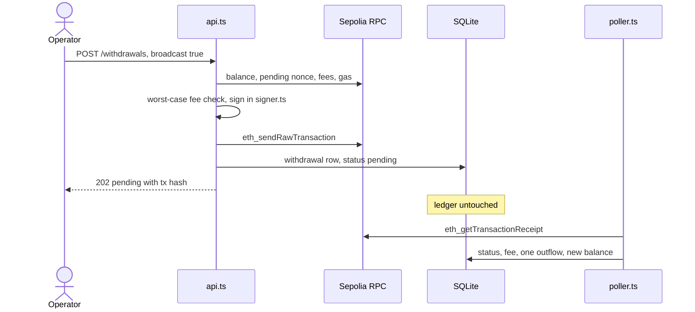
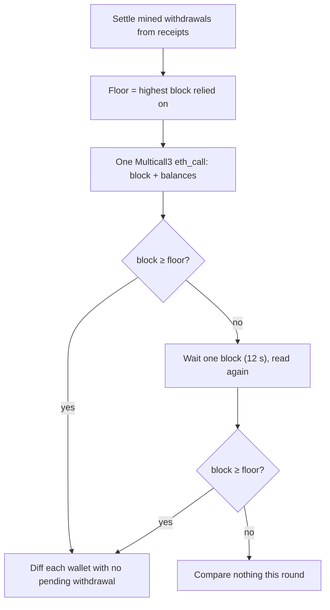

Most bugs in a backend that moves money are boring. A withdrawal gets counted twice because two code paths both noticed the balance drop. An amount passes through a JavaScript `number` and loses its last few wei. Spends get approved against a balance read five minutes earlier, provider API keys end up in log files because the RPC URL was part of an error message, and transactions get signed for a chain nobody meant to touch. None of this needs an attacker.

Wallet Watcher is a small service I built to a written spec: the wallet-and-ledger core of a custody backend, on Ethereum Sepolia, in Node.js and TypeScript. Most of my time went into those failure modes, so that each one is either impossible in the code or shows up in the ledger.

<TLDR>

- Each withdrawal is booked once, by the poller, from its transaction receipt: amount plus `gasUsed × effectiveGasPrice`. A balance diff never books a withdrawal; anything the service did not record shows up as `external_outflow`. This holds within one running process.
- Amounts are `bigint` wei in code, `TEXT` in SQLite and strings in JSON. The API rejects amounts sent as JSON numbers.
- All balances come from one Multicall3 `eth_call` that also returns its block number, and the poller never compares against a block older than one it already relied on.
- A withdrawal is signed only if `balance ≥ value + gasLimit × maxFeePerGas`, on a balance read from the chain just before signing.
- Only `signer.ts` signs, deriving one wallet's key per signature. The HTTP layer receives functions, never the mnemonic or the RPC client.

</TLDR>

## What the service does

It derives N wallets (1 to 20) from one BIP-39 mnemonic at `m/44'/60'/0'/0/i`, so wallet #0 is the same address on every run and raising N only appends. A poller reads every balance at startup, then 8 minutes after each round ends, and writes each change to an append-only ledger in SQLite. A localhost admin API lists the wallets, serves each wallet's ledger, and builds and signs EIP-1559 withdrawals, broadcasting them only when asked.

The stack is Node.js 22.13+ (CI on 24), strict TypeScript, viem, Hono, Zod, the built-in `node:sqlite`, Vitest and Biome. The money logic sits in three pure modules with no I/O (`withdrawal.ts`, `settlement.ts`, `balance-change.ts`), and everything that touches the chain, the database or HTTP stays at the edges. The state fits in three tables:

| Table | What it holds |
|---|---|
| `balances` | One row per wallet: current balance, when it last changed |
| `ledger` | One row per balance change, never updated or deleted |
| `withdrawals` | One row per broadcast: tx hash, amount, `pending`, then `mined` or `reverted` with the real fee |

## A withdrawal, end to end

This is a withdrawal sent with `broadcast: true`. The ledger stays untouched at broadcast time and changes only once the receipt exists.



Without `broadcast`, the request stops after signing and returns the payload, the signature and the serialized `0x02…` transaction. Nothing is sent and nothing is recorded.

## One outflow per withdrawal: the receipt is the only source

The simplest way to record withdrawals is to diff balances and call every drop an outflow. I didn't, because a diff only sees net change, so it cannot split the amount from the fee, and it races with settlement.

Say a round checks for a receipt, finds none, then reads balances. If the transaction is mined between those two calls, the balance read already shows the drop and a diff books it as an `external_outflow`. The next round finds the receipt and books an `outflow` for the same money. The ledger now says the wallet paid twice.

So the code has one rule: only a receipt can produce an `outflow`. At broadcast, the service writes a `withdrawals` row with status `pending`. Each poll round looks up that transaction's receipt, and once it exists, a pure function works out what the wallet paid:

```ts
export const settleWithdrawal = (
  valueWei: bigint,
  receipt: ReceiptSummary,
): Settlement => {
  const feeWei = receipt.gasUsed * receipt.effectiveGasPrice;
  if (receipt.status === "reverted") {
    return { status: "reverted", feeWei, deltaWei: -feeWei };
  }
  return { status: "mined", feeWei, deltaWei: -(valueWei + feeWei) };
};
```

[`src/settlement.ts`](https://github.com/SiegfriedBz/wallet-watcher/blob/HEAD/src/settlement.ts)

A reverted transaction still pays for gas, so it books the fee alone. The status update, the ledger row and the new balance go into one SQLite transaction ([`src/db.ts`](https://github.com/SiegfriedBz/wallet-watcher/blob/HEAD/src/db.ts)), so they cannot disagree after a crash. The poller enforces the other half: any wallet with a pending withdrawal is skipped by the diff for the whole round. And [`detectChange`](https://github.com/SiegfriedBz/wallet-watcher/blob/HEAD/src/balance-change.ts), the diff function, can return `initial`, `inflow` or `external_outflow`, with no path that returns `outflow`.

<Callout title="Design rule">

Only the receipt of a transaction this service broadcast may write an `outflow`. An `external_outflow`, written by the diff, therefore means money left a wallet with no recorded withdrawal behind it, which in a real custody system is an alert.

</Callout>

On Sepolia, wallet #0 received 0.001 ETH, then sent 0.0005 ETH to wallet #1 with broadcast on. At the next poll the service wrote one row: −0.000523183071527 ETH, the 0.0005 ETH amount plus 21,000 gas at an effective price of 1.103955787 gwei, matching the [transaction on Etherscan](https://sepolia.etherscan.io/tx/0x6e8ec949adf6c92f17fe2bb109bf8c79441788312e67a60f1fbe560c5ad1e4a0). On 18 October 2026, wallet #0's on-chain balance (476,816,928,473,000 wei) still equals its last ledger row.

This costs latency: the outflow appears at the first poll after mining, up to 8 minutes late. It also limits each wallet to one withdrawal in flight, and a second broadcast gets a `409` until the first settles. That avoids nonce management, a trade-off I would revisit for production. A deposit that arrives in the meantime is recorded as an `inflow` right after the settlement.

## Exact amounts, from the request to the database

Ether has 18 decimals, so wei amounts outgrow fixed-size numbers quickly:

| Type | Exact integers up to | As wei, in ETH |
|---|---|---|
| JavaScript `number` | 2⁵³ − 1 | about 0.009 |
| SQLite `INTEGER` | 2⁶³ − 1 | about 9.22 |
| `bigint` | no limit | no limit |

Every amount in the code is a `bigint` in wei. SQLite stores amounts as `TEXT`, turned back into `bigint` on read, and JSON carries them as strings: an exact `…Wei` field next to a `…Eth` field for display.

On the request side, if a client sends `1.000000000000000001` as a JSON number, `JSON.parse` turns it into the double `1` before validation runs, and no schema can recover the lost wei. So the amount is accepted only as a string, format-checked, and converted to wei exactly once:

```ts
const ETH_AMOUNT = /^\d+(\.\d{1,18})?$/;

export const AmountEthSchema = z
  .string({ error: 'Amount must be a string, e.g. "0.01"' })
  .regex(ETH_AMOUNT, {
    error: 'Amount must be in ETH with at most 18 decimals, e.g. "0.01"',
    abort: true,
  })
  // Runs only if the regex passed (abort: true), so parseEther never sees bad input.
  .refine((value) => parseEther(value) > 0n, {
    error: "Amount must be greater than 0",
  });
```

[`src/shared/schemas.ts`](https://github.com/SiegfriedBz/wallet-watcher/blob/HEAD/src/shared/schemas.ts)

Without `abort: true`, Zod still runs the refinement after the regex fails, `parseEther("abc")` throws, and a bad request becomes a `500` instead of a `400`. The tests cover the inputs a looser parser would accept (`"1e-3"`, `".5"`, `"1."`, 19 decimals, a JSON number), conversions up to 27 significant digits, and 2⁷⁰ wei written to SQLite and read back exactly.

## Block-consistent reads with Multicall3

The first version of the poller called `eth_getBalance` once per wallet. That is fine against one node, but provider RPC URLs often front a pool of nodes, and two consecutive calls can land a block apart.

Combined with settlement, that produces false rows. The poller gets a receipt from a node at block 100 and writes the outflow. The balance read then hits a node at block 99, where the withdrawal has not happened, so the diff books the difference as an `inflow`, and the next round cancels it with an `external_outflow`. I never saw this on Sepolia; it surfaced in a review of the poller, and it was cheap to close.

The fix has two parts. First, every balance comes from a single `eth_call` to the Multicall3 contract, returning `getBlockNumber()` followed by `getEthBalance(address)` per wallet. One `eth_call` runs on one node against one block, so the balances and the block number describe the same state:

```ts
const [blockNumber, ...results] = await client.multicall({
  allowFailure: false, // a missing balance fails the read, never defaults to 0
  batchSize: 0, // never split into several eth_calls: the snapshot must be atomic
  contracts: calls,
});
```

[`src/chain.ts`](https://github.com/SiegfriedBz/wallet-watcher/blob/HEAD/src/chain.ts)

By default viem splits a multicall once its calldata passes 1,024 bytes, and two chunks mean two `eth_call`s, possibly on two nodes. Twenty wallets stay under that limit, but atomicity should not depend on N, hence `batchSize: 0`. With `allowFailure: false`, one failed sub-call fails the whole read, so a missing balance is never mistaken for a value.

Second, the poller keeps a floor: the highest block it has already relied on, from the previous snapshot or from a receipt it just applied. A snapshot below the floor is never compared:

```ts
const readSnapshotAtOrAfter = async (
  { client, wallets, wait = () => sleep(SNAPSHOT_RETRY_MS) }: PollerDeps,
  floorBlock: bigint,
): Promise<BalanceSnapshot | null> => {
  const addresses = wallets.map((w) => w.address);
  const snapshot = await readBalanceSnapshot(client, addresses);
  if (snapshot.blockNumber >= floorBlock) {
    return snapshot;
  }
  await wait();
  const retried = await readBalanceSnapshot(client, addresses);
  return retried.blockNumber >= floorBlock ? retried : null;
};
```

[`src/poller.ts`](https://github.com/SiegfriedBz/wallet-watcher/blob/HEAD/src/poller.ts)



A round that compares nothing does not advance `lastPolledAt`. The poller tests cover each branch, including a snapshot at block 150 arriving after one at block 200.

<Callout title="What the floor does not cover">

Reads are still made at `latest`. The floor stops the poller from moving backwards in blocks, but it does nothing about reorgs: a reorg can still undo a change the ledger already recorded. The floor also lives in memory, so after a restart the first round only checks against the receipts it applies.

</Callout>

## The worst-case fee check

Under EIP-1559, a transaction pays `gasUsed × min(maxFeePerGas, baseFee + maxPriorityFeePerGas)`, known only once it is mined. Before that, a node accepts it only if the sender covers `value + gasLimit × maxFeePerGas`, so that is the bound the service checks:

```ts
export const planWithdrawal = (input: WithdrawalInputs): WithdrawalPlan => {
  const maxFeeWei = input.gas * input.maxFeePerGas;

  if (input.balanceWei < input.amountWei + maxFeeWei) {
    const maxSendableWei =
      input.balanceWei > maxFeeWei ? input.balanceWei - maxFeeWei : 0n;
    return {
      ok: false,
      reason: "insufficient_funds",
      balanceWei: input.balanceWei,
      maxFeeWei,
      maxSendableWei,
    };
  }
  // ...otherwise build the unsigned type-2 transaction
```

[`src/withdrawal.ts`](https://github.com/SiegfriedBz/wallet-watcher/blob/HEAD/src/withdrawal.ts)

The function is pure; its inputs are read fresh just before it runs. The nonce comes from `eth_getTransactionCount` with the `pending` tag, so the nonce of a transaction still in the mempool is not reused. Fees come from viem's `estimateFeesPerGas` (`maxFeePerGas` = 1.2 × base fee + priority fee), and gas from `eth_estimateGas`. The balance in SQLite can be minutes old, so it never decides a spend.

As a result, sending a wallet's whole balance always fails: the fee comes on top. The API answers `422` with `maxSendableWei`, and the [tests](https://github.com/SiegfriedBz/wallet-watcher/blob/HEAD/test/withdrawal.test.ts) check, on fixed chain inputs, that exactly that amount passes and one wei more fails. Live, fees are read again on every request, so a `maxSendableWei` can be refused a block later. In the Sepolia run, the bound checked before signing was 0.000024728757984 ETH (21,000 gas at a `maxFeePerGas` of 1.177559904 gwei); the fee paid was 0.000023183071527 ETH.

Estimating gas instead of hard-coding 21,000 mattered sooner than I expected. Sepolia's Glamsterdam upgrade raised the cost of a first transfer to a never-used address: on 17 October, `eth_estimateGas` for a 1-wei transfer from wallet #0 returned 207,391 for a fresh address and 21,000 for wallet #1. When the amount is at least the balance, the node may refuse to estimate, so the code skips the estimate and assumes 21,000. The funds check fails anyway, but the `maxSendableWei` it reports is then an upper bound.

## Signing behind one module

The trust boundary is the process and its `.env`. The mnemonic sits in both for the life of the service, and anything that can read either one controls every wallet. That is acceptable on a testnet and is the first thing production changes.

Inside it, `generateWallets` derives each key once at startup, only to compute its address, and returns `{ index, address }`. [`signer.ts`](https://github.com/SiegfriedBz/wallet-watcher/blob/HEAD/src/signer.ts) is the only module that signs: it derives the selected wallet's key for one signature and returns the serialized transaction, its hash and the signature. No private key is stored, cached, logged or returned. The HTTP layer gets less still, because `index.ts` hands `api.ts` functions instead of the mnemonic or the RPC client:

```ts
const app = createApi({
  db,
  wallets,
  chainId: CHAIN.id,
  getLastPolledAt: poller.lastPolledAt,
  adminApiKey: config.ADMIN_API_KEY,
  // The API gets functions, not the client or the mnemonic itself.
  readWithdrawalInputs: (params) => readWithdrawalInputs(chainClient, params),
  signWithdrawal: ({ walletIndex, tx }) =>
    signWithdrawal({ mnemonic: config.MNEMONIC, walletIndex, tx }),
  broadcastTransaction: (serializedTransaction) =>
    chainClient.sendRawTransaction({ serializedTransaction }),
  logRequests: true,
});
```

[`src/index.ts`](https://github.com/SiegfriedBz/wallet-watcher/blob/HEAD/src/index.ts)

Moving signing to a KMS or an MPC service then means replacing one function in the composition root, with no change to `api.ts`. The RPC client is a viem public client with no account, so it can relay a signed transaction but has no key to sign one.

A signed transaction is a bearer instrument, since whoever holds the bytes can broadcast them. So `POST /withdrawals` requires the admin key even without `broadcast`, compared in constant time by Hono's `bearerAuth`. The API binds to `127.0.0.1`, and request logs never include bodies or headers. Errors from viem are logged through [`safeErrorMessage`](https://github.com/SiegfriedBz/wallet-watcher/blob/HEAD/src/shared/errors.ts), which keeps only viem's `shortMessage`: the full message contains the RPC URL, and providers put the API key in it. A test checks that a key present in a viem error's `message` never reaches the log.

## Testnet enforced at startup

The network is chosen in one place (`CHAIN = sepolia`), and at startup the service asks the node for `eth_chainId`. If the answer is not 11155111, it exits before opening the database or starting the poller. The chain id is also part of every signed EIP-1559 payload, so a withdrawal signed here is invalid on any other chain. The database file carries it too (`data/wallet-watcher-11155111.db`), which keeps two networks from ever sharing a ledger.

## Deposits: what a balance diff can and cannot see

The poller compares balances and never reads individual transactions. A diff catches every way ETH can arrive, including transfers made by contracts and validator withdrawals, which credit a balance with no transaction at all. A scan of transactions sent to the wallet would miss both. A diff cannot say which transaction caused a change, though. Itemizing deposits was out of scope, so the design question was what the ledger records:

| Situation | Ledger result |
|---|---|
| +0.1 then +0.2 ETH in one interval | One `inflow` of +0.3 ETH, no tx hash |
| +0.1 ETH in, then an external −0.05 ETH out | One `inflow` of +0.05 ETH |
| Service offline for hours | On restart, settle mined withdrawals, then one row for the rest |

The balance never misses funds; only the per-deposit detail is lost. On Sepolia that detail just got cheaper: since Glamsterdam, plain ETH transfers emit an ERC-20-style `Transfer` log from the system address `0xff…fe` (EIP-7708), which mainnet does not do yet. I would still keep the diff as the source of truth, because validator withdrawals produce no log and logs must be re-read after a reorg.

## How it's tested

The suite has 156 tests in 12 files and runs with no network and no secrets.

| Area | Tests | What they prove |
|---|---|---|
| Request schemas | 42 | Amount formats, checksums, index range, self-send and unknown fields refused |
| Config | 29 | Numeric formats; secrets never in error messages |
| API | 28 | `401` and `400` before any chain call, `422` with max sendable, `202` with no ledger row, `409`, `502` records nothing |
| Wallet generation | 18 | Published test vectors, N + m appends, N − m is a prefix |
| Poller | 8 | One outflow, no double count, deposit during pending, nodes behind the floor |
| Everything else | 31 | Withdrawal planning, database, signer, balance change, chain, errors, settlement |

Derivation, signing and SQLite are real. Tests use Hardhat's public mnemonic (`test test … junk`) and its published addresses, including #19 for N = 20, and the [signer tests](https://github.com/SiegfriedBz/wallet-watcher/blob/HEAD/test/signer.test.ts) recover the address from the signed transaction with `recoverTransactionAddress`. The database runs in memory, and one test makes the ledger insert fail on its `CHECK` constraint after the balance update, then checks that the balance rolled back.

Only the chain is faked. The [poller tests](https://github.com/SiegfriedBz/wallet-watcher/blob/HEAD/test/poller.test.ts) use a client exposing just `multicall` and `getTransactionReceipt`, driven by a small state object, so a test can move the chain between calls or during the wait. The one I would show a reviewer first settles a withdrawal, runs an identical second round, and asserts the ledger still has two rows. API tests inject the chain functions as `vi.fn()` and call the Hono app with `app.request`, with no port.

Not covered: the startup wiring in `index.ts`, the poller's timer loop (`startPoller`), the chain reads before a withdrawal (`readWithdrawalInputs`, including the 21,000-gas fallback) and real RPC behavior; the end-to-end path was run by hand on Sepolia. CI runs typecheck, Biome and tests on every pull request and push to `main`.

## Known limitations

- **Known bug:** if a deposit lands and a withdrawal settles before the poller has seen the deposit, the outflow row's balance-after is computed from the stale stored balance and can be too low, even negative, until the same round books the deposit as an `inflow` (or a later round, up to 8 minutes, if the balance read fails or the node is behind). The deltas stay right. Booking the unseen inflow first (for example from the balance at `receipt.blockNumber − 1`) fixes it.
- "Once" holds inside one process: a crash between `eth_sendRawTransaction` and the insert is booked as `external_outflow`, and a receipt later reorged out stays booked.
- There is no confirmation depth: balances are read at `latest` and a withdrawal settles on its first receipt.
- A transaction that is never mined keeps its wallet pending. No new broadcast is allowed and no diff runs, so a deposit to that wallet goes unrecorded too.
- The one-pending check is not atomic, so two simultaneous broadcasts can both pass. Usually the node rejects the second for its nonce, but one with a high enough fee replaces the first, which then stays pending forever.
- A failed broadcast is ambiguous. A `502` records nothing, yet the node may have accepted the transaction and only the response was lost. The poller would then book it as `external_outflow`, and a retry signs a new transaction with the next nonce, so both go through.
- The 10-minute freshness bound assumes a responsive RPC: viem's timeouts and retries (about 41 seconds at worst for one request) and a 12-second wait for a lagging node can push a round past the 2-minute margin.
- One admin key is shared by every operator.

## Path to production

The README lists what a production custody system would add. Four of those changes would reshape the design itself, and here is how I would make them.

### Keys out of the process

Signing moves to a KMS, an HSM or an MPC service, with a policy engine between request and signature. The service itself only needs to watch: the last two levels of `m/44'/60'/0'/0/i` are non-hardened, so every address derives from the account xpub at `m/44'/60'/0'`. That xpub still needs protecting. It reveals every address, and with any single leaked child private key it gives back the account's private key.

### Record the intent before the send

The ambiguous `502` and the crash window between `eth_sendRawTransaction` and the insert share a fix: persist first. The request carries an idempotency key, and the service stores the signed bytes and hash before it broadcasts. A retry with the same key resends the same bytes, with the same nonce, so at most one can be mined. The same table supports a per-wallet nonce manager, a lock around check, sign and send, and replacing stuck transactions on the same nonce with a higher fee.

### A ledger that survives reorgs

Each ledger row would store the block number and hash it came from, which also keeps the floor across restarts. Deposits get credited at `safe` or `finalized`, or after N confirmations, with pending and available balances shown apart. This version reads `latest` because the freshness target was 10 minutes and `finalized` trails the head by about 13. When a stored hash stops being canonical, the correction is a reversing row, so the ledger stays append-only.

### Policy and observability

Withdrawals need limits, destination allowlists, a second approver above a threshold, per-operator identity and an audit log. For operations, I would track round duration, how far the snapshot trails the head and the age of the oldest pending withdrawal, alert on every `external_outflow`, and make `/health` report poller freshness. The floor also makes RPC failover safer, since a lagging provider can no longer move the ledger backwards.

## Closing

What I would carry into a larger custody codebase is a short list of rules, each of which took a few lines of code and a few tests here. Only a receipt books an outflow. A read never goes back in blocks. A spend is checked against its worst-case cost on fresh chain state. The code that serves requests receives functions, never secrets.

The code, the full README and the Sepolia walkthrough are on [GitHub](https://github.com/SiegfriedBz/wallet-watcher).
